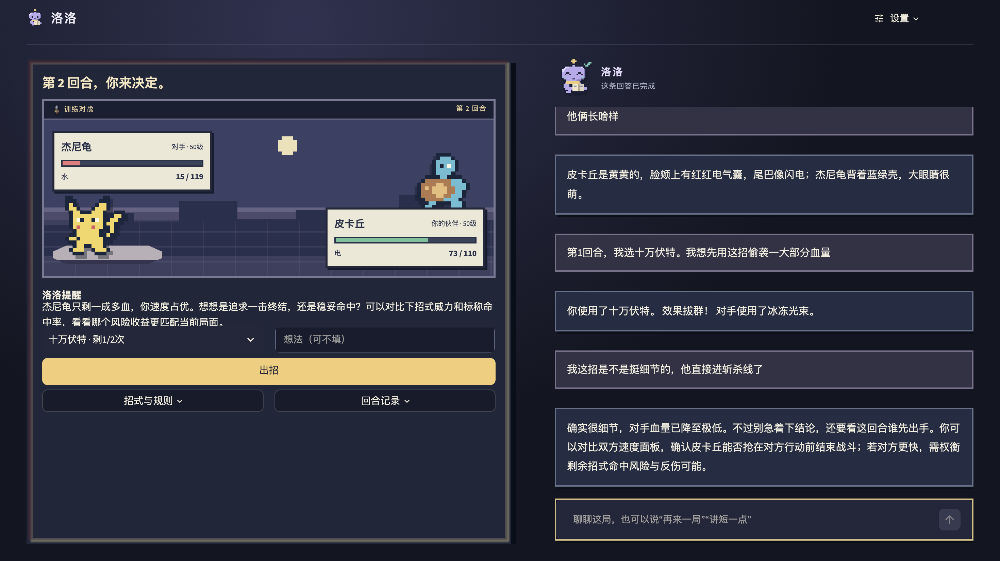
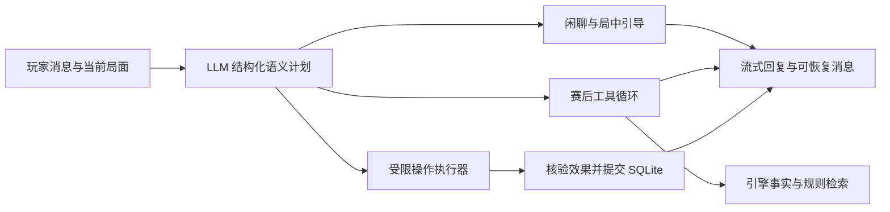

# RocoCoach 洛洛

[](https://github.com/yqadv356/RocoCoach/actions/workflows/tests.yml)

**一个陪玩家打完整局、解释关键选择、把复盘变成下一次练习的 LLM 教练。**

玩家自己出招，洛洛负责引导观察、查证规则、记住明确偏好，并在赛后帮助玩家改进。军师、陪练和老师融合在同一个聊天入口；项目优先完成老师的教学流程闭环。

**整局练习 → 回合前引导 → 自主决策与真实结算 → 证据复盘 → 下一局训练目标**

[文档导航](docs/README.md) · [设计与实现](docs/SUBMISSION_DRAFT.md) · [下载 PDF](submission/RocoCoach_设计与实现.pdf) · [下载 Word](submission/RocoCoach_设计与实现.docx) · [五分钟演示与代码导航](docs/REVIEWER_GUIDE.md)



*用户提供的运行截图，展示对战、出招理由和洛洛的聊天引导。实现与验证范围见[验证说明](docs/VALIDATION.md)。*

## 怎样体验

1. 开始一场训练，查看生命、属性、招式与剩余次数。洛洛提示观察方向，玩家独立选招。
2. 连续完成多个回合，随时聊天或询问规则；聊天本身不推进对局。
3. 结束后立即看到赛果，教师复盘在后台生成并流式显示。
4. 追问某回合的依据，或赛后比较另一招的单回合重放；主局保持不变。
5. 在聊天中请求下一场进阶训练，或说以后讲短一些；操作保存成功后才反馈完成。

目前支持四个固定教学场景、标准与进阶两档对手。进阶按公开状态评估直接伤害与命中，不偷看玩家当回合选择，也不修改战斗数值。

## 技术设计



| 设计重点 | 实现方式 | 解决的问题 |
| --- | --- | --- |
| 聊天驱动操作 | 模型理解请求，程序核对结果，同一请求只执行一次 | 避免只口头答应重开，或重复创建新局 |
| 可解释建议 | 对局快照、版本化规则、工具回执、证据引用 | 区分发生的事实、规则资料和模型解释 |
| RAG | 26 条固定来源资料，词法 BM25、实体与覆盖范围筛选 | 来源可追溯，未知内容不凑答案 |
| 上下文与记忆 | 当前局面、近期完成对话、显式偏好、学习事件 | 承接指代；失败草稿不进入事实记忆 |
| 流式与复盘 | 请求绑定消息、草稿检查点、原位置完成展示、后台复盘 | 减少终局等待，避免已显示文字被收尾覆盖 |
| 原创像素洛洛 | 事件驱动待机、查证、讲解、完成四态 | 提供过程反馈，不增加模型请求 |

[提交前功能检查与真实调用](docs/FINAL_ACCEPTANCE.md)

深入阅读：[智能体](docs/AGENT_EXECUTION_DESIGN.md) · [RAG](docs/RAG_IMPLEMENTATION.md) · [流式生命周期](docs/RESPONSE_LIFECYCLE.md) · [后台复盘](docs/ASYNC_REVIEW.md) · [像素伙伴](docs/MASCOT_DESIGN.md)

## 快速运行

需要 **Python 3.12、Node.js 24、pnpm 11**。以下命令适用于 macOS/Linux；云端已在 Linux 验证，Windows 尚未完整验证。

```sh
git clone https://github.com/yqadv356/RocoCoach.git
cd RocoCoach
python3.12 -m venv .venv
source .venv/bin/activate
python -m pip install -r requirements.txt
python scripts/setup_battle.py
python -m streamlit run app.py --server.address 127.0.0.1
```

打开 [本地训练场](http://127.0.0.1:8501)。无密钥也能运行明确标记的规则演示，验证对局和交互；它不代表真实 LLM 能力。按 `Control+C` 停止服务。

已安装 uv 可用 `uv sync --frozen` 安装 Python 依赖，再执行引擎安装与启动步骤。VS Code 打开仓库后选择 `.venv/bin/python`，已有启动和测试配置。

### 使用真实模型

```sh
cp .env.example .env
```

在本地 `.env` 填写账户可用的模型与密钥，例如项目实测配置：

```dotenv
LLM_PROVIDER=qwen
LLM_MODEL=qwen3.8-flash
LLM_API_KEY=填写自己的密钥
LLM_BASE_URL=https://dashscope.aliyuncs.com/compatible-mode/v1
```

也兼容已有 `OPENAI_API_KEY`、`OPENAI_MODEL` 配置，`LLM_*` 字段优先。模型是否可用取决于账户与地域。真实请求会把问题、受限对局事实、近期对话和显式偏好发送给配置的服务商，并产生调用费用。密钥仅放本地，勿提交 `.env` 或私人记录。

## 验证结果

| 验证层次 | 已记录结果 | 能说明什么 |
| --- | --- | --- |
| GitHub 全新 Linux 环境 | [227 项通过，196.61 秒](https://github.com/yqadv356/RocoCoach/actions/runs/41082691035) | 基线提交 `4c2f381` 可安装并通过回归；最新运行看页首徽章 |
| 本机完整回归 | 227 项通过，83.85 秒 | 引擎、工具约束、事务、消息恢复与像素状态等程序检查规则 |
| 真实 LLM 操作 | 两例实际创建并保存进阶新局 | 真实调用与实际副作用链路，不是总体成功率 |
| 真实语义探索 | 同一 14 题集，两轮均 13/14 | 保留误判；不是独立盲测或通用准确率 |
| RAG 固定回归 | 可答 Hit@2 为 16/16，越界为空 4/4 | 同题修正后的检索回归，不等于回答正确率 |

自动化包含模型替身。尚未通过真实玩家实验证明教学、胜率或留存提升。[验证口径与证据](docs/VALIDATION.md)记录样本、版本及限制。

```sh
python -m pytest -q
python scripts/evaluate_rag.py --output rag-evaluation-local.json
```

## 项目结构

```text
app.py / pages/       Streamlit 入口与页面
rococoach/           语义计划、工具、对局、检索、记忆与消息生命周期
engine/              Showdown 与 Smogon 的固定版本适配
assets/              界面、原创像素伙伴及有许可记录的素材
data/                公开语料与合成评测；私人数据不进入仓库
tests/               回归测试
docs/                设计、难点、证据与阅读导航
submission/          Word 与 PDF 项目说明书
scripts/             安装、评测与交付工具
```

## 实现范围与复用

这是宠物对战教学原型，复用 Pokémon Showdown 和 Smogon 处理结算与计算，**未接入《洛克王国》真实接口，也不代表其实际规则**。短局次数是双方一致、可按版本重放的自定义训练规则。

尚未实现完整阵容系统、任意宠物配置、自适应长期课程、Agentic RL、长期 Reflection、多 Agent 或向量数据库。后续优先补独立语义与教学质量评审、延迟和用量统计，再决定是否扩大技术栈。

来源与许可见 [THIRD_PARTY.md](THIRD_PARTY.md)。原创代码尚未单独授予开源许可证；公开展示不等于授予第三方游戏 IP。Codex 参与代码、调试与文档，新增工作的边界见[设计稿](docs/SUBMISSION_DRAFT.md)和[公开工程记录](docs/PUBLIC_BUILD_LOG.md)。
