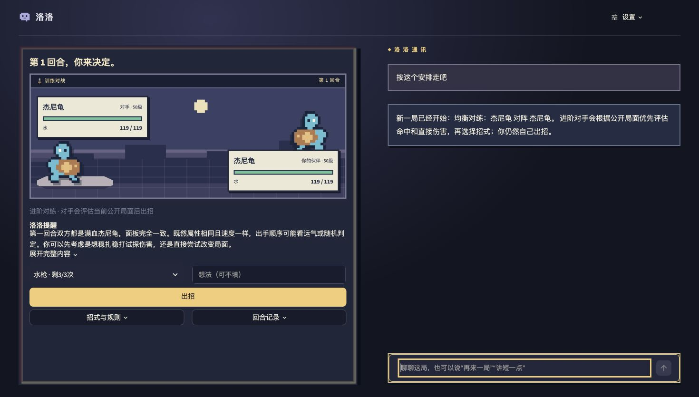

# RocoCoach 洛洛

[](https://github.com/yqadv356/RocoCoach/actions/workflows/tests.yml)

基于 LLM 的宠物对战教练原型。**完整一局 → 回合前引导与自主出招 → 证据复盘 → 下一局练习目标**，军师、陪聊和老师融合在一个聊天入口。



图示来自独立合成局：真实模型理解“按这个安排走吧”，宿主实际开启并保存均衡进阶新局。它不是玩家私人记录。

## 先看这些

- [设计与实现初稿](docs/SUBMISSION_DRAFT.md)：题目对齐、架构、难点、修复、验证与限制。
- [面试官阅读导航](docs/REVIEWER_GUIDE.md)：五分钟演示及关键代码入口。
- [智能体执行机制](docs/AGENT_EXECUTION_DESIGN.md)：语义计划、上下文确认、受限能力、结果核验与事务提交。
- [RAG 工程说明](docs/RAG_IMPLEMENTATION.md)：26条固定来源、BM25、覆盖边界和基线对照。
- [原创洛洛像素伙伴](docs/MASCOT_DESIGN.md)：四种事件状态、可关闭动画与界面验证。
- [第三方组件和许可](THIRD_PARTY.md)。

[阅读 PDF 初稿](submission/RocoCoach_设计与实现_面试初稿.pdf) · [下载 Word 初稿](submission/RocoCoach_设计与实现_面试初稿.docx)。以本页和当前初稿为准；开发工作区其他历史说明保留各阶段事实，不混称当前版本。

## 能做什么

- 四个固定教学场景，真实多回合结算、次数耗尽和同配置回放。
- 局中只给公开因素引导，玩家自己出招；赛后可查关键回合并实际重放另一个行动一个回合。
- 真实模型聊天、结构化语义路由、近期对话、明确偏好和本地学习摘要。
- 在对话中要求新训练、确认上一条方案、改变之后的讲解风格；只有实际提交成功后才反馈操作完成。
- 标准对手随机合法出招；进阶对手按公开局面评估直接伤害与命中，不修改数值或偷看本回合选择。
- 真实流式正文、后台整局复盘、失败可见草稿保存与刷新恢复。

主攻老师的流程闭环。尚未证明教学效果、胜率或留存提升；进阶不是全局最优策略。没有完整阵容系统、任意宠物配置、Agentic RL、长期 Reflection、多 Agent 或向量数据库。

## 快速运行

需要 **Python 3.12、Node.js 24 和 pnpm 11**。本机实际验证为Node 24.22.1、pnpm 11.25.0。Windows 激活路径不同，下面命令针对 macOS/Linux；跨平台完整验证尚未完成。

```sh
python3.12 -m venv .venv
source .venv/bin/activate
python -m pip install -r requirements.txt
python scripts/setup_battle.py
python -m streamlit run app.py --server.address 127.0.0.1
```

打开 http://127.0.0.1:8501 。无模型密钥时页面明确使用规则演示，能验证引擎和交互，但不能代表真实 LLM 能力。只需启动一个服务；终端按 Control+C 停止。

已安装 uv 也可用 `uv sync --frozen` 替代 Python 依赖安装，再运行上述 Node 依赖安装和启动步骤。VS Code 打开项目后选择 `.venv/bin/python`，已有启动和测试配置。

## 接入真实模型

复制 `.env.example` 为本地 `.env`，填写账户可用的模型 ID 和 API Key。当前真实实测使用 qwen3.8-flash；是否可用由个人账户/地域决定。

```dotenv
LLM_PROVIDER=qwen
LLM_MODEL=qwen3.8-flash
LLM_API_KEY=填写自己的密钥
LLM_BASE_URL=https://dashscope.aliyuncs.com/compatible-mode/v1
```

也支持已有 `OPENAI_API_KEY` 和 `OPENAI_MODEL`（LLM字段优先），以及其他兼容提供商。`.env`、私有SQLite和模型用量都留在自己机器；不要提交密钥。真实调用会发送当前问题、受限对局事实、近期对话和显式偏好到配置的服务商，并产生账户费用；不要在公开演示中输入私人信息。

## 验证

```sh
python -m pytest -q
python scripts/evaluate_rag.py --output rag-evaluation-local.json
```

当前本机完整回归 **227 passed in 94.45s**（含发布检查与洛洛状态测试）。自动化包含模型替身，证明程序契约，不代表227条自然语言回答正确。真实模型意图探索两轮均13/14，保留失败；两项独立真实操作均核验创建和保存成功。完整证据解读见阅读导航。

GitHub Actions 配置用于在无密钥环境安装锁定依赖并运行回归；只有仓库实际运行成功后才能宣称 CI 通过。

## 目录

```text
app.py / pages/          Streamlit 主入口与页面
rococoach/              语义计划、工具、对局、RAG、记忆与流式生命周期
engine/                 固定版本 Showdown 与 Smogon 适配
assets/                 本地界面、原创像素示意与注明许可的素材
data/                   公开语料与合成评测；private/ 不进入交付包
tests/                  宿主契约、引擎、页面与故障回归
scripts/                安装、独立实测、语料构建、交付检查
```

## 范围与复用

规则复用宝可梦公开组件，是宠物对战教学原型，**不是洛克王国真实接口或规则模拟**。自定义短局次数和进阶策略有版本记录。Showdown、Smogon、PokeAPI与RPGUI各按自己的许可保留署名；原创代码尚未单独授予开源许可证，公开展示不等于授予第三方游戏 IP。

Codex参与代码、调试与文档；第三方提供基础引擎与计算。项目新增的是整局教学流程、语义动作、证据适配、上下文、执行约束、持久化与验证。运行Demo与材料都应由候选人亲自理解、复述和操作后再提交。
