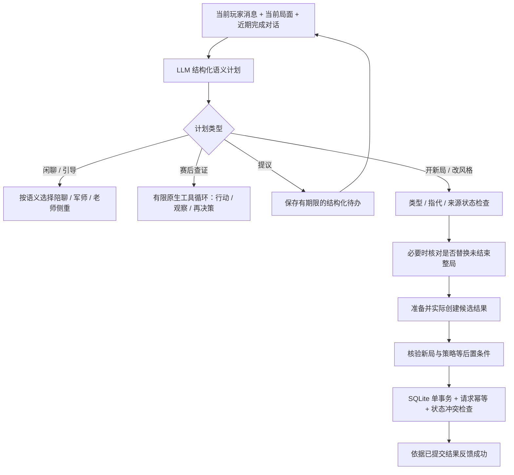

# 从“能回答”到“能可靠执行”的智能体

2026-10-30，当前实现说明。入口是 `match_coach.match_chat`，不是一套针对“好的”“难一点”的回复替换表。当前范围仍是三天单机原型：老师学习闭环优先，不扩展成通用游戏代理。

## 为什么调整

之前在线操作先经过中文关键词候选判断，再经过另一套否定/确认短语判断。模型即使理解需求，宿主也可能挡住合理表达；普通教学又可能口头承诺开局，却没有执行路径。此前流式失败还会将草稿覆盖成固定观察。这些是不同层的问题，分别处理，不能靠多加一句提示词解决全部。

在线现在统一读取当前消息、局中/赛后阶段、场景、策略档位、近期完成对话、最新助手提议和仍相关的结构化待办，生成严格 `IntentPlan`。模型选择意图、回应侧重和受限参数；程序负责合法性、状态一致性、实际效果和保存。未完成/失败草稿不参与后续上下文。离线旧规则独立留在 `offline_control.py`，只服务明确的规则演示。

## 能力契约与授权边界

| 能力 | 参数与实际效果 | 核验 |
| --- | --- | --- |
| `start_new_match` | 已有四场景或沿用；标准/进阶或沿用。新随机种子，使用短局次数规则，保留旧局 | 新ID、零历史、零帧、未结束、场景/策略/规则版本均与计划一致 |
| `set_response_style` | 简洁、详细、引导式三个枚举；只改明确的后续表达偏好 | 不改对战状态，保留昵称/心情，实际写入档案 |
| `propose_new_match` | 保存待办ID、精确参数、来源状态token、5分钟期限 | 尚未开局；只有仍相关的当前确认才能执行 |
| 赛后只读/分支工具 | 公开观察、整局、关键回合、回合详情、规则检索、学习记忆、独立回合分支 | 阶段白名单、严格参数、输入/输出哈希、实际工具凭据，真实局面不得改变 |

简单写操作采用“结构化语义计划→类型化能力准备→宿主执行”，不是把JSON意图伪称为原生function calling。复杂赛后查证继续使用真实原生工具调用的有限循环。自动复盘则由宿主预取必要证据再总结，trace明确标记宿主，不假称模型自主选了这些工具。

当前确认语义由模型结合上下文判断，没有在线固定肯定词列表。新提议使用类型化待办，执行精确保存的参数；旧版本留下的纯文本提议兼容语义绑定最新助手消息摘要，提交时再核对所指消息未变。当前用户的接受才是执行授权，旧文本只是指代对象。新的“接受并修改”应生成修改后的新请求，不能忽略修改而执行原待办。

话题改变后旧待办失效；过期、局面变化、方案被替换时不执行。提交核对当前输入哈希、对局token和提议身份，使用同一 `request_id` 幂等保存。已处理旧请求不能将页面跳回过去。数据库事务合并期间新增的复盘/消息，避免用规划前快照覆盖最新记录。模型无法写任意档案字段、SQL或运行代码，也不能通过聊天工具替玩家出招。

语义分类不是形式化授权证明：模型可能误分讨论、确认或含糊请求。特别是替换未结束整局，增加独立的语义副作用核对；它与主规划使用同一提供商，错误可能相关，不能把两次调用相乘当安全概率。缺少明确指向就自然澄清；规划服务失败不会退回关键词自动执行。

## “难一点”具体改变什么

`standard` 保留原随机合法对手；`challenge` 使用 `public-damage-v1`：从当前可见状态计算每个可用行动的 `(最低直接伤害+最高直接伤害)/2 × 标称命中率`，选择最高分。复用现有Smogon计算与Showdown结算，不另造伤害公式，不读玩家尚未结算的选择，不加攻击/血量或修改随机数。未指定场景的进阶需求选杰尼龟镜像均衡对练，避免靠火克草的一边倒冒充进阶。

策略档位和次数规则写入快照、后续推进、公开事实和赛后分支复现参数；旧记录缺档位按标准处理。此策略不完整评估状态收益、长线资源、回合优先级或制胜概率，不是全局最优、官方段位，也不保证每个随机种子都更难。单个镜像种子样例由标准7回合玩家3生命获胜变成进阶7回合对手14生命获胜，只说明策略确实改变，不能作为胜率实验。

## 可复查的证据

- 最终自动化回归：**221 passed in 86.33s**。类型契约、非执行语义、过期/串话确认、事务冲突、幂等、真正策略与同配置重放、流式失败保留、网页开局/刷新等。意图单元测试使用明确模型替身，验证宿主约束，不证明真实语义准确率。
- `semantic-actions-live-evidence.json`：独立临时SQLite、合成结束局、真实千问，直接请求进阶 **2.143秒**；先提议再确认 **3.431秒**（含两次理解）。两个例子都实际创建/保存零回合进阶新局，五项后置检查全通过。不是总体延迟统计。
- `semantic-intent-probe-evidence.json` 和 `semantic-intent-probe-normalized-evidence.json`：同一14项探索集两次真实运行均 **13/14**。首次失败为等价类型表达：模型返回 `start_new_match + confirmation + reference`，统一正规化为 `confirm_pending`，保留raw_intent。第二次失败为局中“再做一次”被解释为重开。两份失败保留，未把探索集包装为独立盲测或通用准确率。
- `active-replacement-check-evidence.json`：真实副作用复核，将局中“再做一次”判断为不应直接替换，“这局从头开始，我想重新打一遍”判断为明确替换。两例未执行开局，不代表所有语义边界都可靠。
- `semantic-agent-execution-preview.png`：8502隔离合成局、真实模型配置，在最近提议之后输入“按这个安排走吧”，页面实际切换均衡进阶第1回合、双方119/119，成功反馈来自已提交回执；刷新保持。无原用户历史和代出招操作。合成初始复盘使用离线内容，操作意图和新局引导使用真实模型。

探索集在提示词冻结后整理，记录提示/schema与数据哈希；仍由同一开发者编写，不算独立评审。不要通过持续改测试期望、补专用短语或只展示成功样例制造准确率。后续应在冻结版本后独立收集多轮指代、语义相近但动作不同、混合需求与故障用例，再人工标注执行意图和实际效果。

## 代价与仍需完善

每条在线人工消息增加一次意图模型调用，探索样例约1.4–3秒；要替换未结束整局时可能再多一次核对。不宣传零额外延迟。页面即时显示理解状态，现有聊天正文仍流式输出；写操作成功反馈必须等实际保存，不能流式提前宣布成功。自动回合引导不额外走人工意图规划。

只支持四个已有场景与两档对手，尚未实现任意阵容生成、自适应课程、多用户权限、生产任务队列或跨窗口草稿仲裁。RAG仍是26条词法BM25资料检索，无向量库；没有Agentic RL训练、长期Reflection或多智能体协商。程序校验能验证引用/阶段/状态契约，不能证明所有自然语言结论。已有旧失败正文不被追溯改写成成功。
