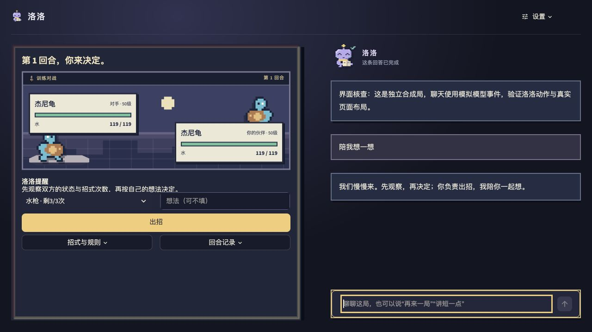

# RocoCoach：面向宠物对战的 LLM AI Coach——设计、实现与验证

面试作品说明书　2026年10月31日　公开实现基线 43fba45

## 一 交付摘要与题目对齐

RocoCoach 将一场宠物对战连接成可解释的练习过程：回合前引导观察，玩家自主出招，赛后结合真实记录复盘，再带着一个目标开始下一局。项目优先完成“老师”的教学流程闭环，军师与陪练作为部分能力融入同一个聊天入口。

### 核心贡献

1. 让语言落实为操作。LLM 生成结构化意图，程序在受限权限内创建新局或保存表达偏好，并核验实际结果；模型说“已完成”本身不算执行成功。

2. 让教学有事实可查。Node 对战引擎负责结算，Agent 可查实际回合、检索版本化规则、独立重放某回合的另一招；参数、结果与来源均可检查。

3. 把建议连接到练习。保留玩家理由、整局过程、复盘和下一局目标，支持继续追问与对话开局，完成练习与反馈链路。尚未证明学习迁移、胜率或留存提升。

| 题目角色 | 已实现能力 | 当前边界 |
| --- | --- | --- |
| 老师 | 引导、自主决策、整局复盘、下局目标 | 教学流程闭环；学习增益待评估 |
| 军师 | 解释公开因素、赛后查证与单回合重放 | 部分能力；无完整阵容规划 |
| 陪练 | 闲聊、近期上下文、显式偏好与像素伙伴 | 部分能力；关系与情绪质量未独立评测 |

原型复用 Pokémon Showdown 0.11.11 与 Smogon calc 0.12.0，提供四个固定教学场景。尚未接入《洛克王国：世界》的官方规则、数据或接口，不将宝可梦机制当作洛克王国实际机制。

交付包含可运行 Streamlit Demo、源码、Word/PDF 和验证记录。仓库：[yqadv356/RocoCoach](https://github.com/yqadv356/RocoCoach)。程序闭环、真实模型样例与尚未验证内容在下文分别说明。

## 二 玩家流程与交互设计

### 先自己判断 再依据记录改进

玩家查看生命、状态、属性和剩余次数。洛洛提示观察维度，玩家自主选招，也可补充一句理由；聊天不推进回合。引擎保存行动前后快照和实际事件，避免赛后仅凭对话文本重构战况。

整局结束后立即显示赛果，后台生成复盘。玩家可追问某回合或实际重放另一招，再用下局目标继续练习。当前打通练习与反馈流程，未自动测量掌握度，也不把独立小测页称为自适应课程。

### 统一入口与公平边界

玩家无需切换“军师／陪练／老师”按钮，问题与场景决定回应侧重。局中只给公开观察，不展示逐招排名或最佳答案；赛后再开放细算和替代行动。左侧对战、右侧聊天，桌面输入框保持可见，规则和执行凭据按需展开。

### 原创像素伙伴

洛洛按真实请求事件呈现待机、查证、讲解和完成，失败时保留草稿；动画可关闭，不增加模型调用。形象未复制 Codex 宠物素材或接入桌面宠物 API，其陪伴价值仍待玩家评估。



图 1 统一入口与桌面布局。独立合成局，聊天使用模拟模型事件，仅用于界面验证；不作为真实模型效果证据。

## 三 架构与一次请求的数据流

```architecture
玩家与 Streamlit 界面：自主操作、统一聊天、请求状态与流式展示
↓ LLM 语义规划：严格 IntentPlan，结合当前阶段、问题与近期上下文
普通聊天与局中引导\n受限公开局面与完成对话\n不通过聊天替玩家出招 || 赛后证据查询\n原生 Function Calling 有限循环\nLLM 选工具 ↔ 宿主返回 Observation || 结构化意图与受限写操作\nIntentPlan → 参数与状态核验\n执行 → 结果核验 → 事务保存
↓ 按阶段与能力读取或写入；并非每次请求都调用全部组件
Pokémon Showdown / Smogon\n真实回合结算与伤害范围\nPython / Node 适配 || 本地 BM25 风格 RAG\n规则、招式与物种资料\n来源、版本与覆盖边界 || SQLite\n对局、偏好、学习事件\n操作回执与消息状态
```

图 2 三条执行路径及其事实与状态来源。语义规划不直接修改状态；写操作由程序执行。局中自动提示可直接使用公开事实，不必再次进行人工消息意图规划。

### 三条路径的实现区别

普通聊天与引导：读取阶段允许的局面和近期完成对话，再生成相应风格的回复。普通聊天按提供商真实流展示，局中提示先检查是否泄露具体答案。

赛后查询：模型使用原生 Function Calling 选择工具及参数，Python 宿主检查、执行，把实际 Observation 返回模型；模型可继续查证或结束回答。该路径用于解释具体对局，不授权任意代码执行。

对话操作：模型输出结构化 IntentPlan，程序准备开局或偏好变更，核验后提交并生成回执。它不是通过原生 Function Calling 完成的开局操作，计划也不代表已经执行。

自动整局复盘另走宿主预取路径：应用程序读取整局、关键回合与回合详情，再交给模型总结。轨迹明确标记宿主选择，不将预取伪称模型自主调用。

### 可解释性与职责边界

可展示的是工具、参数、结果、来源、版本和回执，不是隐藏思考。引擎结算、资料事实与模型解释分别处理；引用存在或哈希一致不证明自然语言结论正确。换接真实游戏仍需授权、机制适配、合法行动接口和重新评测。

## 四 智能体如何可靠执行

### 一次实际的赛后查证

用户问：“这局哪些回合值得回看？请查关键回合再结合具体记录解释。”合成整局使用真实千问 qwen3.8-flash。以下顺序直接取自 final-match-tools-evidence.json，没有补写模型 Thought。

| 模型步骤 | 实际工具与参数 | Observation 与后续动作 |
| --- | --- | --- |
| 第 1 次调用 | find_key_turns {} | 返回第 1、7、8 回合候选；终局和生命变化是筛选线索，不是失误判定 |
| 第 2 次调用 | inspect_round {turn: 7}<br>inspect_round {turn: 8} | 同一步请求两个回合详情；宿主依次返回真实状态、事件、理由与赛后计算 |
| 第 3 次调用 | inspect_round {turn: 1} | 模型收到前序 Observation 后补查开局记录 |
| 第 4 次调用 | 无新增工具，生成最终回复 | 引用候选与已读取回合，解释开局、较大生命变化和终局；文字结论仍须另行评估 |

该样例为 4 次模型调用、4 次工具调用，Agent 循环耗时 16.769 秒，不是端到端性能分位数。它展示 ReAct 式调用循环：LLM 选择工具与参数 → Python 执行 → Observation 返回 → LLM 继续查询或回答；未复现经典 ReAct 训练，也不公开或编造隐藏思考。

同文件另一问实际调用 inspect_round → simulate_round_alternative → search_rules，独立重放第 2 回合：实际双方剩余生命为 79／99，改用撞击的分支为 79／95。主局不变；该固定种子单回合样例不估计胜率或因果效果，改变行动也可能改变随机数消耗。

### 权限与提交由程序掌握

写能力仅 start_new_match 与 set_response_style，限四场景、两档对手与三种表达风格。IntentPlan 使用严格字段与枚举；不能写任意 SQL、代码或档案。确认方案还检查待办、当前指代、来源状态与五分钟期限，替换未结束整局增加语义副作用复核。

程序创建候选新局后核对新 ID、零回合、未结束、场景、档位和规则版本，再以 request_id 防重复，在 SQLite 事务中核对旧状态、合并消息、保存新局和回执。仅在保存成功后回复“新局已开始”。

赛后工具循环上限为五次模型请求、八次工具、七十五秒，受阶段白名单与参数约束。进阶对手使用公开直接伤害区间均值乘标称命中率的启发式评分，不偷看玩家本轮选择，也不代表最优战术。

## 五 RAG 与上下文机制

### 小型知识库与可追溯检索

知识库共 26 条：4 条原型原则、17 条招式、5 条物种。机制从固定版本 Showdown Dex 导出，记录来源定位、包版本、条目与整库内容哈希。物种可能拥有某特性，不代表本局已装备该特性；资料也不能代替当前生命、状态或天气。

本地检索将中文双字片段、英文词与显式别名送入 BM25 风格词法评分，k1=1.2、b=0.75；结合实体与覆盖筛选，返回前两条。轨迹保留查询、候选分项分数、入选资料与版本。未覆盖时返回未找到，不用另一招资料凑答案。没有 embedding、向量数据库或模型重排。

| 相同 20 题集的对照 | 可答 Hit@2 | 未覆盖返回空 |
| --- | --- | --- |
| 4 条资料与原关键词 | 5/16 | 2/4 |
| 26 条资料与原关键词 | 12/16 | 2/4 |
| 新检索首次对应版本 | 15/16 | 4/4 |
| 修正后同题回归 | 16/16 | 4/4 |

题集含 16 个可答问题、4 个未覆盖问题，均为人工合成。首次失败用于修正后，后续成绩只称同题回归，不再称独立留出。Hit@2 只表示前两条命中预标注相关资料，不是回答正确率；提升同时受语料扩展、实体筛选和排序影响，不能全部归因于 BM25。

### 分层上下文与明确记忆

上下文由当前引擎状态、近期完成对话、明确偏好和最近学习摘要组成。普通近期对话最多六轮，语义规划五轮，工具循环使用更短窗口；学习摘要取最近五条。SQLite 保存完整整局，模型只读取当前阶段允许的受限视图。

生成中或失败草稿可以留给玩家查看，但不进入正常模型对话上下文，也不计作已确认学习成果。当前 Memory 是显式偏好、学习事件与有界上下文；未实现完整 Memory Stream 或自动长期人格提炼。

赛后复盘属于反馈与反思流程，不等于训练算法。项目没有 Agentic RL、多 Agent、MCTS 或 PPO 训练；采用现有模型完成语义理解和解释。下一步先评估记忆是否改善跨局教学，再考虑更复杂的记忆组织。

## 六 难点与修复依据

### 口头说已开局 实际没有执行

问题：玩家要求“再来一局难一点的”，模型给出方案或口头承诺，却没有创建新对局。

原因：早期短语路由、助手提议和状态更新脱节，未把理解意图、准备操作、实际保存和最终反馈连成可核验过程。

方案：以结构化语义计划承接请求及确认，程序校验参数和来源状态，准备候选新局并核对实际效果；request_id 保证同一请求只提交一次，事务同时保存新局、消息和回执。模型服务失败不降级为关键词自动执行。

结果与边界：提交前真实模型两例检查了新 ID、零回合、进阶策略和实际保存，分别为 4.425、7.260 秒；网页另用合成历史检查确认后开局及刷新保持。早期语义探索仍有含糊重试误判，因此补了未结束整局的副作用复核；少量样例不能保证所有指代正确，多用户并发未完整验证。

### 流式文字生成后消失

问题：玩家看到内容逐字出现，结束或重绘后却被空白或固定观察替换，单纯开启 stream 无法解决。

原因：中文展示过滤误杀英文昵称，末尾校验失败覆盖正文，后台片段与整页重绘撤掉占位，消息又未按同一请求持续保存。早期只测成功返回，遗漏了完整展示生命周期。

方案：用 request_id 绑定同一条生成中消息，明确生成、完成、失败状态；约半秒保存一次可见草稿，完成或失败均更新原消息。后台片段持续拥有自己的展示位置。失败保留可见版本并标明未完整核对，后续上下文排除这些草稿。

结果与边界：回归覆盖失败、多版草稿、重复刷新和上下文排除；真实流式样例最终正文未被占位替换。保存不是逐字落盘，进程瞬断仍可能丢失少量内容；后台线程不具备服务重启恢复。

### 其他取舍

终局等待：先展示已保存赛果，冻结快照并后台预取证据，最多两次总结修正、四十秒预算；不将预取说成自主 Agent。短局次数：双方基础次数除十向上取整，由引擎实际扣减，旧局保留规则版本；尚无平衡实验。像素状态：由各片段持有自己的展示区域，按真实任务状态更新；只验证展示，不证明陪伴收益。

## 七 验证结果与证据解释

### 以提交前验收批次为主

| 验证项 | 核对结果 | 能证明什么 |
| --- | --- | --- |
| GitHub Actions 43fba45 | 227 项通过，117.42 秒 | Ubuntu 全新安装与程序回归；包含模型替身 |
| 同批本机完整回归 | 227 项通过，83.85 秒 | 程序契约与故障处理；非新机器复现 |
| 真实千问操作 | 开局 4.425 秒；确认 7.260 秒；风格保存 4.589 秒 | 两例创建并保存；风格改变未重开对局 |
| 真实赛后工具 | 关键回合 4 模型／4 工具；换招 4 模型／3 工具 | 实际查询与单回合引擎重放，主局未变 |
| 真实后台流式复盘 | 首正文 4.458 秒；最终核验 11.625 秒 | 流式与保存链路；不证明语义正确 |
| 同题 RAG 回归 | 可答 Hit@2 为 16/16；未覆盖空返 4/4 | 小型人工题集的检索回归，非答案准确率 |
| 独立浏览器离线检查 | 8 回合、复盘保存、刷新、聊天重开、两种视口 | 合成局页面至数据库链路，非真实模型评测 |

本轮实现基线为公开提交 43fba45；该基线对应已核验成功运行 [Actions 41144977412](https://github.com/yqadv356/RocoCoach/actions/runs/41144977412)。本次只优化提交材料，不将该运行自动算作后续提交已通过。

较早两轮语义探索均为 13/14，较早复盘为 1.490／10.331 秒，另见[验证记录](VALIDATION.md)。不与本轮合并为整体准确率；本轮步骤见[最终验收](FINAL_ACCEPTANCE.md)。

### 工具正确不等于解释正确

final-async-review-evidence.json 中，工具记录为杰尼龟的 Torrent（激流），模型却写成“猛火（Torrent）”。固定引擎的 Torrent 增强水属性攻击，Blaze 才对应火属性；该局实际使用咬住，不能据 Torrent 解释其伤害优势。模型还把第 6 回合结束的己方 46 生命，与该回合开始时对手 18 生命放在同一时点，实际开局双方为 65／18、结束为 46／0；“这一选择直接决定胜势”等因果表述也超出已有比较证据。

应分开检查工具执行、引用与结构、自然语言机制解释。当前部分程序契约验证了前两类，未全面证明第三类；validated_final 仅是程序校验状态。原始错误样本保留，不声称语义问题已彻底解决。下一步补机制名称一致性检查、证据充分性评估和独立人工标注的回答质量测试。

## 八 交付演示与后续优先级

### 面试现场怎样演示

先说明老师闭环与引擎复用边界，开始均衡训练；查看回合前引导，自主选招并写理由，穿插一句闲聊确认不推进回合。整局结束后看即时赛果、后台复盘和下局目标；追问一个已发生回合的替代行动，展开真实工具凭据；最后用聊天要求进阶新局，检查第 1 回合与保存回执，并演示表达偏好。

网络或模型失败时使用明确标记的已保存合成证据，不把截图当实时响应。无密钥规则演示可以验证游戏与保存流程，不能称为真实 LLM。当前没有公共在线服务，127.0.0.1 只在运行 Demo 的电脑可访问。

### 提交与复查入口

正式提交以本说明书 PDF 为主，Word 为可编辑备份。公开仓库提供源码、锁定依赖、安装步骤、测试与合成证据；运行需要 Python 3.12、Node.js 24、pnpm 11。真实模型密钥只放本地 .env，不提交密钥、私人记录、虚拟环境或数据库。

源码与运行：[GitHub 仓库](https://github.com/yqadv356/RocoCoach)。阅读导航：[REVIEWER_GUIDE](REVIEWER_GUIDE.md)。事实与组件许可：[THIRD_PARTY](../THIRD_PARTY.md)。变更过程：[PUBLIC_BUILD_LOG](PUBLIC_BUILD_LOG.md)。发布附件：[面试提交基线](https://github.com/yqadv356/RocoCoach/releases/tag/v0.1.0-interview)；该标签对应此前固定版本，本轮正式稿以仓库 submission 目录为准。

### 三天范围与下一步

范围安排依次是可运行整局与事实接口、教练与受限工具、失败恢复和验证交付；这是任务分解，不是测得的个人工时。优先补独立意图与回答语义评估、机制一致性、延迟分位数与费用记录，再验证下局目标能否迁移到玩家自主判断。没有真实玩家学习、胜率或留存实验，不作效果承诺。

生产化还需多用户认证、记忆查看与删除、持久任务队列、并发仲裁和真实游戏适配；Windows 全流程也未完整验证。现阶段不为增加术语扩展训练栈。

### 自研 复用与 AI 辅助的边界

Codex 辅助代码、调试和文档；Showdown 与 Smogon 提供结算和计算，PokeAPI 提供部分中文名称，RPGUI 提供部分像素界面资源，均保留来源与许可。新增工作是教学流程、语义动作及结果核验、证据工具适配、上下文、消息恢复与验证。候选人需能亲自解释和演示这些取舍，不冒称独立编写第三方引擎或训练了新模型。
